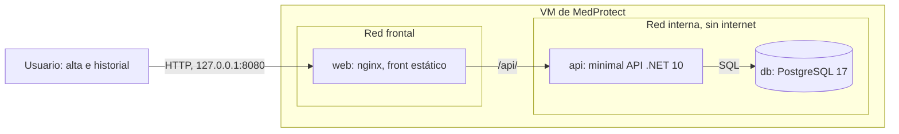

# Arquitectura de MedProtect

Alta de pacientes y mini historial clínico: un front estático, una minimal API en .NET 10 y PostgreSQL 17, en contenedores.

## Contenedores



| Servicio | Carpeta | Imagen | Sin shell | Usuario | Puerto |
|---|---|---|---|---|---|
| `web` | `webclient/` | `cgr.dev/chainguard/nginx` | Sí | 65532, sin root | 8080, publicado solo en 127.0.0.1 |
| `api` | `webapi/` | `mcr.microsoft.com/dotnet/aspnet:10.0-noble-chiseled` | Sí | 1654 (`app`), sin root | 8080, sin publicar |
| `db` | `db/init/` | `dhi.io/postgres:17` | No (ver abajo) | 70 (`postgres`), sin root | 5432, sin publicar |

## Cómo se levanta

```sh
cp .env.example .env         # cambien la contraseña: .env no se versiona
docker compose up -d --build
docker compose ps            # api y db deben decir "healthy"
curl http://127.0.0.1:8080/api/health/ready
```

| Ruta | Qué dice |
|---|---|
| `/` | El front, con el estado de la API y de la base |
| `/api/health` | La API está viva. No toca la base |
| `/api/health/ready` | Además llega a PostgreSQL. Con la base apagada responde 503 |
| `/api/pacientes`... | Las rutas del SRS: responden 501 "Por implementar" hasta que el equipo las construya |

Para borrar todo, incluidos los datos: `docker compose down -v`.

## Lo que ya viene decidido

Lo fijó el instructor al iniciar el repositorio. **No cuenta como ADR del equipo.**

- **Minimal API en .NET 10 y front estático.** El producto es chico (alta e historial) y el curso está en .NET 10.
- **PostgreSQL 17.**
- **Imágenes sin shell y sin root.** Si alguien compromete la API o la web, no tiene shell, ni gestor de paquetes, ni root con qué moverse.
- **La excepción es la base.** No hay una imagen distroless de PostgreSQL 17 que arranque sola: su arranque usa un script de shell para crear la base la primera vez. Se usa la imagen endurecida de Docker (`dhi.io/postgres:17`): corre sin root, viene firmada, trae lo mínimo y vive en una red sin salida a internet. Si encuentran una alternativa mejor, es material para un ADR suyo.
- **Solo la web publica un puerto, y solo en 127.0.0.1.** La API y la base solo se alcanzan por las redes internas de Docker.
- **Contenedores con sistema de archivos de solo lectura**, sin capacidades de Linux (`cap_drop: ALL`) y sin poder escalar privilegios (`no-new-privileges`).
- **Secretos en `.env`**, que no se versiona. En el repositorio solo va `.env.example` con valores de ejemplo.

> **Ojo en la VM:** Docker publica puertos por fuera de UFW. Abrir la web a la red del salón es una decisión del equipo, con ADR, y se prueba desde otra laptop igual que el señuelo de la sesión 2.

## Lo que construye el equipo

| Sesión | Qué | Dónde |
|---|---|---|
| 2 | Modelo de amenazas, ADR, VM endurecida | `docs/seguridad/`, `docs/adr/` |
| 3 | Las rutas del SRS: alta, consulta e historial, con autenticación, roles y validación | `webapi/`, `db/init/`, `docs/srs/` |
| 4 | Base con rol mínimo, respaldos y despliegue con el usuario `deploy` | `compose.yaml`, `db/` |
| 5 | Bitácoras, monitoreo y respuesta a incidentes | `docs/seguridad/` |
| 6 | Pentest cruzado y defensa | `docs/seguridad/` |
