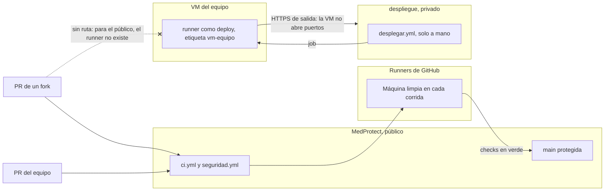

# Guía paso a paso: un runner de GitHub Actions en la VM

Cómo instalar en su VM un runner autohospedado de GitHub Actions sin abrirle la puerta a nadie de fuera. Es el paso 8 de la práctica 2 de la sesión 4, y el mismo runner es el que puede desplegar en la sesión 5. Al final, la sección [Cómo lo hace el dev-stack](#cómo-lo-hace-el-dev-stack) compara esta instalación con los runners reales con que el instructor despliega sus productos.

- **Conduce:** {DEVOPS} (DevOps). **Crea el repositorio privado:** {TECH_LEAD}. **Verifica y junta evidencia:** {RESPONSABLE_SEGURIDAD}.
- **Sistema:** la VM endurecida de la sesión 2. Usuarios: `equipo` (administra, con sudo) y `deploy` (despliega, sin sudo).
- **Donde dice `ip-de-su-vm`** va la IP de su VM, y **`{CUENTA_GITHUB}`** la cuenta dueña de MedProtect. Ninguna IP ni token se escribe en el repositorio: es público.
- Nadie pega un comando que no pueda explicar.

---

## La regla, antes de instalar nada

Un runner autohospedado ejecuta el código del workflow **en su VM**. En un repositorio público, eso es una puerta abierta:

1. Cualquiera hace un fork de MedProtect.
2. En su copia escribe `runs-on: self-hosted`.
3. Abre un pull request. La corrida usa el workflow **de su commit**, no el de ustedes.
4. Su código corre en la VM: la red del salón, el disco, y lo que haya dejado una corrida anterior.

Un `if:` en el YAML no los salva: el atacante trae su propio YAML. GitHub lo dice directo: los runners autohospedados casi nunca deben usarse en repositorios públicos.

**La solución del curso:** los controles (`ci.yml` y `seguridad.yml`) corren en runners de GitHub. El runner de la VM se registra en un **repositorio privado, `despliegue`**, que solo tocan los integrantes.



**El alcance lo fija el registro, y es definitivo.** Un runner registrado contra `github.com/{CUENTA_GITHUB}/despliegue` no puede tomar trabajos de otro repositorio, diga lo que diga el YAML. No es un permiso que alguien active después: es justo la propiedad que buscan.

> **Si la cuenta es una organización** y prefieren registrarlo a nivel organización: los grupos de runners traen la opción de permitir repositorios públicos **apagada**. Déjenla así, y limiten el grupo al repositorio `despliegue`.

---

## Lo que necesitan

| Qué | Para qué | Cómo se comprueba |
|---|---|---|
| La VM endurecida de la sesión 2 | El runner hereda lo que la VM permite | `docs/seguridad/checklist-vm.md` completo |
| `deploy` sin sudo | El runner corre los jobs como el usuario que lo arranca | `sudo -l -U deploy` dice `not allowed to run sudo` |
| Salida a `github.com` por el 443 | El runner **llama** a GitHub; nadie llama a la VM | `curl -sI https://github.com \| head -1` da `HTTP/2 200` |
| Alguien con `equipo` en una terminal | Instalar el servicio pide sudo | `sudo -v` sin error |
| El dueño de la cuenta | Crear el repositorio privado y ver la lista de runners | Es quien creó MedProtect |

UFW de la sesión 2 deja pasar el tráfico de salida (`default allow outgoing`): no hay que abrir nada.

---

## Paso 1. El repositorio privado `despliegue` (3 minutos, Tech Lead)

1. En GitHub, **New repository**. Dueño: **{CUENTA_GITHUB}**, la misma cuenta de MedProtect. Nombre: `despliegue`. Visibilidad: **Private**. Con un README.
2. **Settings, Collaborators:** agreguen a los integrantes que van a desplegar.
3. **Settings, Actions, General, Workflow permissions:** *Read repository contents*.

Los runners autohospedados no gastan minutos de GitHub, también en un repositorio privado.

---

## Paso 2. Instalar el runner como `deploy` (7 minutos)

En el repositorio `despliegue`: **Settings, Actions, Runners, New self-hosted runner**, **Linux**, **x64**. Esa página trae tres datos que cambian: la versión, la suma SHA-256 del archivo y el token de registro. Tómenlos de ahí.

```sh
# Terminal A, desde su laptop
ssh equipo@ip-de-su-vm

# Todo lo que sigue, como deploy. config.sh se niega a correr como root, y está bien que lo haga.
sudo -iu deploy
mkdir actions-runner && cd actions-runner

curl -fsSLo runner.tar.gz \
  "https://github.com/actions/runner/releases/download/v{VERSION_RUNNER}/actions-runner-linux-x64-{VERSION_RUNNER}.tar.gz"
# Si la suma no coincide, el archivo no es el que publicó GitHub: no se descomprime.
echo "{SUMA_RUNNER}  runner.tar.gz" | sha256sum --check --strict
# runner.tar.gz: OK
tar xzf runner.tar.gz && rm runner.tar.gz

./config.sh --url "https://github.com/{CUENTA_GITHUB}/despliegue" \
  --token PEGUEN-AQUI-EL-TOKEN \
  --name {NOMBRE_RUNNER} \
  --labels vm-equipo \
  --work _work \
  --unattended
# √ Runner successfully added
# √ Settings Saved.

exit   # de regreso a equipo
```

Como referencia, el 2026-11-08 la versión era `2.338.2` y la suma de linux-x64, `baebf204307bac6193480852732f0aba2ae97b6c5597c244f4d5558390147c40`. **La que vale es la de la página el día que lo instalen.** Después el runner se actualiza solo.

**El token de registro** es de un solo uso y caduca en una hora. Va en la consola, **nunca** en el repositorio, en una captura ni en el chat del equipo: con él, cualquiera registra **su** máquina en `despliegue` y recibe sus despliegues. Si se filtró, generen otro y borren de la lista el runner que no reconozcan.

Si `config.sh` se queja de bibliotecas que faltan (`libicu`), instálenlas desde `equipo`: `sudo /home/deploy/actions-runner/bin/installdependencies.sh`.

---

## Paso 3. Dejarlo como servicio (2 minutos, como `equipo`)

Sin servicio, el runner muere al cerrar la terminal. `svc.sh` lo instala en systemd **para que corra como `deploy`**, no como root:

```sh
sudo sh -c 'cd /home/deploy/actions-runner && ./svc.sh install deploy && ./svc.sh start'
sudo sh -c 'cd /home/deploy/actions-runner && ./svc.sh status'
# Active: active (running)

# Con qué usuario corre de verdad
ps -o user=,cmd= -C Runner.Listener
# deploy   /home/deploy/actions-runner/bin/Runner.Listener run --startuptype service

# Su bitácora en vivo
sudo journalctl -u 'actions.runner.*' -f
# ... Listening for Jobs
```

En GitHub, **Settings, Actions, Runners** lo muestra **Idle**, en verde, con las etiquetas `self-hosted`, `Linux`, `X64` y `vm-equipo`.

**Un servicio que se pierde al reiniciar no estaba puesto:** `sudo reboot`, y en dos minutos el runner debe volver a **Idle** sin que nadie lo toque.

---

## Paso 4. `desplegar.yml` en el repositorio privado (5 minutos)

1. Copien [`.github/plantillas/desplegar.yml`](../../.github/plantillas/desplegar.yml) de este repositorio a `.github/workflows/desplegar.yml` en `despliegue`.
2. En `despliegue`, agreguen también `.github/actionlint.yaml`, para que una etiqueta mal escrita salga en actionlint y no en un job colgado:

   ```yaml
   self-hosted-runner:
     labels:
       - vm-equipo
   ```

3. **Actions, desplegar, Run workflow.** El job `comprobar` debe decir:

   ```
   deploy
   nombre-de-su-vm
   deploy
   ok   deploy sin sudo
   ```

   Al pegar esta salida como evidencia, cambien el nombre real de la VM por `nombre-de-su-vm`.

El workflow solo escucha `workflow_dispatch`: lo dispara a mano alguien con permiso de escritura en el privado. Nunca `pull_request` ni `push`, aunque el repositorio sea privado: el runner de la VM solo corre lo que el equipo decidió correr.

---

## Paso 5. Verlo fallar: el público no alcanza el runner (5 minutos)

**Si no lo vieron fallar, no lo probaron.** Hagan que MedProtect pida el runner y comprueben que nadie lo toma:

```sh
# En su laptop, en el clon de MedProtect
git switch -c practica/runner-inalcanzable
mkdir -p .github/workflows
cat > .github/workflows/inalcanzable.yml <<'EOF'
name: inalcanzable
on: pull_request
permissions:
  contents: read
jobs:
  probar:
    runs-on: [self-hosted, linux, vm-equipo]
    steps:
      - run: echo "Si esto corre en la VM, el runner quedó mal registrado"
EOF
git add .github/workflows/inalcanzable.yml
git commit -m "prueba: el runner de la VM no se alcanza desde el público, no fusionar"
git push -u origin practica/runner-inalcanzable
```

Abran el pull request. El job **no sale en rojo**: se queda en *Waiting for a runner to pick up this job*. Esa espera **es** la prueba.

1. Capturen el job esperando.
2. Cancélenlo, **cierren el pull request sin fusionar** y borren la rama.

La misma prueba desde la API (la lista de runners solo la ve el dueño de la cuenta):

```sh
gh api repos/{CUENTA_GITHUB}/MedProtect/actions/runners --jq '.total_count'
# 0
gh api repos/{CUENTA_GITHUB}/despliegue/actions/runners \
  --jq '.runners[] | "\(.name) \(.status) \([.labels[].name] | join(","))"'
# {NOMBRE_RUNNER} online self-hosted,Linux,X64,vm-equipo
```

**Para ver fallar la guarda de sudo**, como `equipo`:

```sh
sudo usermod -aG sudo deploy
sudo sh -c 'cd /home/deploy/actions-runner && ./svc.sh stop && ./svc.sh start'
# Corran desplegar.yml: debe salir en rojo. Capturen, y regresen:
sudo gpasswd -d deploy sudo
sudo sh -c 'cd /home/deploy/actions-runner && ./svc.sh stop && ./svc.sh start'
# Corran desplegar.yml otra vez: verde.
```

El servicio no ve un grupo nuevo hasta reiniciarse: si se saltan el reinicio, la prueba miente.

---

## Evidencia

Se pega aquí y en Classroom. Las capturas sin IP ni token.

| Qué | Evidencia | Quién |
|---|---|---|
| Runner en `despliegue`, **Idle**, con la etiqueta `vm-equipo` | Captura de Settings, Actions, Runners | {INTEGRANTE} |
| Corre como `deploy`, sin sudo | `{SALIDA}` del job `comprobar` | {INTEGRANTE} |
| Vuelve solo después de `sudo reboot` | `{SALIDA}` de `./svc.sh status` | {INTEGRANTE} |
| El público no lo alcanza | Captura del job esperando, y PR cerrado sin fusionar | {INTEGRANTE} |
| Cero runners en MedProtect | `{SALIDA}` de `gh api .../MedProtect/actions/runners` | {INTEGRANTE} |
| La guarda de sudo falla cuando debe | Captura del rojo y del verde al regresar | {INTEGRANTE} |

---

## Cómo lo hace el dev-stack

El dev-stack es la infraestructura de desarrollo compartida con la que el instructor corre sus productos en Raptor Dev Services: una sola base PostgreSQL, almacenamiento, correo de prueba, monitoreo y los runners de GitHub Actions de todos los repositorios. Sus runners resuelven el mismo problema que el de ustedes a otra escala. Lo que transfiere y lo que no:

| En el dev-stack | Por qué | En su VM |
|---|---|---|
| Runners **en contenedores**, con la imagen oficial `ghcr.io/actions/actions-runner`, varios iguales que se reparten los jobs | Muchos repositorios y builds a la vez; cada pipeline trae sus herramientas con `docker run` | **Uno solo, instalado como servicio.** Un equipo y un repositorio de despliegue no necesitan más |
| Montan el **socket de Docker** del host | Los despliegues hacen `docker compose up` en esa máquina | **El socket de Docker equivale a root.** Por eso aquí el runner no va en contenedor: como servicio de `deploy` hereda exactamente lo que `deploy` puede hacer. Si en la sesión 5 despliega con Docker, `deploy` entra al grupo `docker`, que también es root en la VM: eso va con ADR |
| Cada runner se registra **una vez** y guarda sus credenciales en su carpeta: al reiniciar no pide token | El token caduca en una hora | Igual: las credenciales quedan en `/home/deploy/actions-runner`, de `deploy`. El token no se guarda en ningún lado |
| **Una etiqueta por rol** (`build`, `staging`), y los que solo compilan se registran sin las etiquetas de omisión (`--no-default-labels`) | Un job que pide `[self-hosted, linux]` no debe caer en la máquina que no despliega | `vm-equipo`, y el job pide las tres: `[self-hosted, linux, vm-equipo]` |
| **La máquina que despliega no compila.** Otra compila y publica la imagen; la de staging solo la baja y la levanta | El CPU de staging queda para las APIs y la base | Su VM es chica. Compilar en GitHub y que la VM solo levante es una opción real para su ADR de la sesión 5 |
| `concurrency` en cada job de despliegue | Dos despliegues a la vez se pisan | Ya viene en la plantilla: `group: despliegue`, sin cancelar |
| La limpieza programada **no escucha `pull_request`** | Su repositorio era público, y esos runners tienen el socket de Docker | `desplegar.yml` solo escucha `workflow_dispatch` |
| Una tarea nocturna vacía la carpeta `_work` de cada runner | Los builds llenan el disco antes que cualquier otra cosa | Revisen de vez en cuando `du -sh /home/deploy/actions-runner/_work` |
| `RUNNER_NAME_PREFIX` distinto en cada máquina | Dos máquinas con el mismo nombre se quitan los runners una a la otra, sin avisar | Un `{NOMBRE_RUNNER}` único. Si instalan otro, otra carpeta y otro nombre |

---

## Trampas que ya le costaron una tarde a alguien

| Síntoma | Qué es | Qué hacer |
|---|---|---|
| El job dice *Waiting for a runner* y nunca termina, sin rojo y sin log | Un `runs-on` mal escrito, **o** el runner caído: los dos dan lo mismo. GitHub lo cancela a las 24 horas | `./svc.sh status` en la VM, y la lista de runners en `despliegue`. Prevengan con actionlint (paso 4) |
| El runner desapareció de la lista | Pasó **14 días** sin conectarse y GitHub lo dio de baja | Token nuevo, `./config.sh remove` y configurar otra vez (paso 2) |
| `actions/setup-dotnet` falla con `mkdir: Permission denied` | Intenta instalar en `/usr/share/dotnet`, y `deploy` no puede escribir ahí. En los runners de GitHub no pasa porque ahí el usuario tiene sudo | En el job: `env: DOTNET_INSTALL_DIR: ${{ runner.tool_cache }}/dotnet`. **No** le den sudo a `deploy` |
| Cancelaron un job y el contenedor que lanzó sigue vivo | Cancelar detiene el job, no el `docker run` que ya arrancó | Nombren los contenedores que lanza el job y bórrenlos al empezar el siguiente |
| Agregaron `deploy` a un grupo y el job no lo ve | El servicio conserva los grupos con que arrancó | `sudo sh -c 'cd /home/deploy/actions-runner && ./svc.sh stop && ./svc.sh start'` |
| `config.sh` dice `Must not run with sudo` | Lo corrieron como root | `sudo -iu deploy` y otra vez desde la carpeta del runner |

---

## Quitar el runner

```sh
# Como equipo: detener y quitar el servicio
sudo sh -c 'cd /home/deploy/actions-runner && ./svc.sh stop && ./svc.sh uninstall'

# Como deploy: darlo de baja en GitHub. El token de baja sale en Settings, Actions, Runners, el runner, Remove.
sudo -iu deploy
cd actions-runner && ./config.sh remove --token PEGUEN-AQUI-EL-TOKEN-DE-BAJA
```

---

## Referencias

- GitHub Docs: *Adding self-hosted runners*, *Configuring the self-hosted runner application as a service* y *Removing self-hosted runners*.
- GitHub Docs: *Secure use reference* y *Managing access to self-hosted runners using groups*: los runners autohospedados, solo con repositorios privados.
- GitHub Docs: *Actions limits*: un job espera runner hasta 24 horas.
- Laster, B. (2023). *Learning GitHub Actions*, caps. 5, "Runners", y 9, "Actions and Security". O'Reilly.
