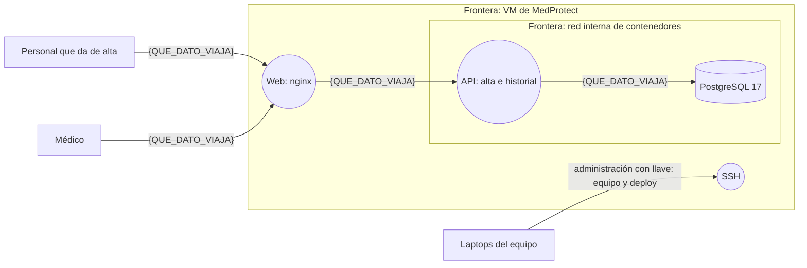

# Modelo de amenazas de MedProtect

- **Versión:** v1
- **Fecha:** {FECHA}
- **Conduce:** {RESPONSABLE_SEGURIDAD} (responsable de seguridad)
- **Dibuja el diagrama:** {TECH_LEAD} (Tech Lead)
- **Atacan el diagrama:** todo el equipo

> Las cuatro preguntas que ordenan este documento: **¿En qué estamos trabajando?** (secciones 1 y 2), **¿Qué puede salir mal?** (sección 5), **¿Qué vamos a hacer?** (secciones 3, 4, 5 y los ADR) y **¿Lo hicimos bien?** (columna "Cómo se ve fallar" y `checklist-vm.md`).
>
> Repositorio público: nada de direcciones IP, nombres de la VM, contraseñas ni llaves.

---

## 1. Datos que maneja el producto

La materia prima del modelo: qué datos personales guarda MedProtect y quién querría robarlos. El producto da de alta pacientes y lleva un mini historial clínico: **los datos de salud son datos personales sensibles** en la ley mexicana (LFPDPPP), y eso sube lo que está en juego.

Pistas para empezar: los datos de identificación del paciente, sus datos de contacto, cada entrada del historial, quién la escribió y cuándo, y las cuentas de quienes usan el sistema.

| Dato | Dónde vive | Quién lo ve | Quién querría robarlo y para qué | Sensibilidad |
|---|---|---|---|---|
| {DATO} | {DONDE_VIVE} | {QUIEN_LO_VE} | {QUIEN_Y_PARA_QUE} | {PUBLICO_INTERNO_PERSONAL_O_SENSIBLE} |
| {DATO} | {DONDE_VIVE} | {QUIEN_LO_VE} | {QUIEN_Y_PARA_QUE} | {PUBLICO_INTERNO_PERSONAL_O_SENSIBLE} |
| {DATO} | {DONDE_VIVE} | {QUIEN_LO_VE} | {QUIEN_Y_PARA_QUE} | {PUBLICO_INTERNO_PERSONAL_O_SENSIBLE} |
| {DATO} | {DONDE_VIVE} | {QUIEN_LO_VE} | {QUIEN_Y_PARA_QUE} | {PUBLICO_INTERNO_PERSONAL_O_SENSIBLE} |
| {DATO} | {DONDE_VIVE} | {QUIEN_LO_VE} | {QUIEN_Y_PARA_QUE} | {PUBLICO_INTERNO_PERSONAL_O_SENSIBLE} |

---

## 2. Diagrama de flujo de datos

Se modela **lo que es hoy**, no lo que debería ser: incluyan la VM, el acceso por SSH y lo que todavía no existe pero ya está diseñado (la API y el front están iniciados en `webapi/` y `webclient/`; ver `docs/arquitectura/README.md`). Cinco símbolos: entidad externa, proceso, almacén, flujo y frontera.

En cada flecha escriban **qué dato viaja**. Ajusten los elementos: quiten los que no aplican y agreguen los que falten (por ejemplo, si un tercero recibe datos). GitHub dibuja el bloque al abrir el archivo; si Mermaid les quita tiempo, suban una foto del pizarrón a `docs/seguridad/img/` y enlácenla aquí.

**Fronteras de confianza y por qué:**

| Frontera | Qué separa | Qué la cruza |
|---|---|---|
| VM de MedProtect | {QUE_SEPARA} | {QUE_FLUJOS_LA_CRUZAN} |
| Red interna de contenedores | {QUE_SEPARA} | {QUE_FLUJOS_LA_CRUZAN} |
| {OTRA_FRONTERA} | {QUE_SEPARA} | {QUE_FLUJOS_LA_CRUZAN} |

---

## 3. Nivel de ASVS

**Nivel elegido:** {NIVEL_ASVS}

**Por qué:** {JUSTIFICACION_NIVEL}

> L1 es la primera capa. L2 es a donde debería apuntar la mayoría. L3 es defensa en profundidad. **MedProtect guarda datos de salud:** si eligen L1, expliquen por qué les alcanza; si no, suban.

---

## 4. Requisitos de arranque

Un requisito se cita con su versión y se prueba en alguna sesión. Un requisito que nadie puede reprobar todavía no es un requisito.

| Requisito | Nivel | Qué pide | Se prueba en | Estado |
|---|---|---|---|---|
| v5.0.0-8.2.2 | 1 | Acceso a datos específicos solo con permiso explícito sobre esos datos | Sesión 3 | {ESTADO} |
| v5.0.0-6.3.1 | 1 | Controles contra fuerza bruta y relleno de credenciales | Sesión 3 | {ESTADO} |
| v5.0.0-6.3.3 | 2 | Segundo factor para entrar a la aplicación | Sesión 3 | {ESTADO} |
| v5.0.0-13.4.1 | 1 | Desplegar sin metadatos de control de versiones, como `.git` | Sesión 5 | {ESTADO} |
| v5.0.0-16.3.1 | 2 | Registrar cada autenticación, exitosa o fallida | Sesión 5 | {ESTADO} |
| {REQUISITO_ASVS} | {NIVEL} | {QUE_PIDE} | {SESION} | {ESTADO} |

---

## 5. Amenazas

Mínimo **diez**, con **las seis letras de STRIDE**. Empiecen por los flujos que cruzan una frontera. Al menos **tres sobre la VM**: alimentan la práctica 2.

Una amenaza bien escrita dice **quién**, **qué hace**, **por qué puede** y **qué pierden**, y ya trae su prueba adentro: "nos pueden hackear el servidor" no es una amenaza.

| ID | Elemento | STRIDE | Amenaza: quién, qué hace, por qué puede, qué pierden | Impacto | Prob. | Riesgo | Decisión | Control o requisito | Cómo se ve fallar | Estado |
|---|---|---|---|---|---|---|---|---|---|---|
| A-01 | SSH | S | **Ejemplo de la clase:** un atacante en la red prueba contraseñas contra SSH, porque el acceso por contraseña sigue activo, y entra como `equipo`, que tiene sudo | Alto | Media | Alto | Mitigar | SSH solo con llave | Entrar con contraseña: `Permission denied (publickey)` | {ESTADO} |
| A-02 | {ELEMENTO} | {LETRA} | {AMENAZA} | {IMPACTO} | {PROB} | {RIESGO} | {DECISION} | {CONTROL} | {COMO_SE_VE_FALLAR} | {ESTADO} |
| A-03 | {ELEMENTO} | {LETRA} | {AMENAZA} | {IMPACTO} | {PROB} | {RIESGO} | {DECISION} | {CONTROL} | {COMO_SE_VE_FALLAR} | {ESTADO} |
| A-04 | {ELEMENTO} | {LETRA} | {AMENAZA} | {IMPACTO} | {PROB} | {RIESGO} | {DECISION} | {CONTROL} | {COMO_SE_VE_FALLAR} | {ESTADO} |
| A-05 | {ELEMENTO} | {LETRA} | {AMENAZA} | {IMPACTO} | {PROB} | {RIESGO} | {DECISION} | {CONTROL} | {COMO_SE_VE_FALLAR} | {ESTADO} |
| A-06 | {ELEMENTO} | {LETRA} | {AMENAZA} | {IMPACTO} | {PROB} | {RIESGO} | {DECISION} | {CONTROL} | {COMO_SE_VE_FALLAR} | {ESTADO} |
| A-07 | {ELEMENTO} | {LETRA} | {AMENAZA} | {IMPACTO} | {PROB} | {RIESGO} | {DECISION} | {CONTROL} | {COMO_SE_VE_FALLAR} | {ESTADO} |
| A-08 | {ELEMENTO} | {LETRA} | {AMENAZA} | {IMPACTO} | {PROB} | {RIESGO} | {DECISION} | {CONTROL} | {COMO_SE_VE_FALLAR} | {ESTADO} |
| A-09 | {ELEMENTO} | {LETRA} | {AMENAZA} | {IMPACTO} | {PROB} | {RIESGO} | {DECISION} | {CONTROL} | {COMO_SE_VE_FALLAR} | {ESTADO} |
| A-10 | {ELEMENTO} | {LETRA} | {AMENAZA} | {IMPACTO} | {PROB} | {RIESGO} | {DECISION} | {CONTROL} | {COMO_SE_VE_FALLAR} | {ESTADO} |

**Cómo se llena:**

- **STRIDE por elemento.** No todas las letras aplican a todo. Entidad externa: S, R. Proceso: las seis. Almacén: T, R (si guarda bitácoras), I, D. Flujo: T, I, D.
- **Riesgo** = probabilidad por impacto, con la matriz de abajo.
- **Decisión:** *Mitigar* (agregar o cambiar un control), *Eliminar* (quitar la función o dejar de guardar el dato) o *Aceptar* (con dueño, razón y fecha de revisión, en un ADR). Lo que se acepta sin escribirlo no se aceptó: se olvidó.
- **Estado:** cuando el control se ve fallar en la VM, cambien de "Mitigar" a "Verificado".

### Matriz de riesgo

| Impacto / Probabilidad | Baja | Media | Alta |
|---|---|---|---|
| **Alto** | Medio | Alto | Alto |
| **Medio** | Bajo | Medio | Alto |
| **Bajo** | Bajo | Bajo | Medio |

### Cobertura de STRIDE

| Letra | Qué rompe | Amenazas |
|---|---|---|
| S, Spoofing (suplantación) | Autenticación | {IDS} |
| T, Tampering (manipulación) | Integridad | {IDS} |
| R, Repudiation (repudio) | Trazabilidad | {IDS} |
| I, Information disclosure (divulgación) | Confidencialidad | {IDS} |
| D, Denial of service (denegación) | Disponibilidad | {IDS} |
| E, Elevation of privilege (elevación) | Autorización | {IDS} |

---

## 6. Riesgo residual y amenazas aceptadas

El riesgo residual es lo que queda después del control: también se decide y se escribe.

| Amenaza | Qué queda después del control | Quién lo acepta | ADR | Se revisa el |
|---|---|---|---|---|
| {ID} | {RIESGO_QUE_QUEDA} | {INTEGRANTE} | ADR-{NUMERO} | {FECHA} |

---

## Historial

| Versión | Fecha | Qué cambió | Quién |
|---|---|---|---|
| v1 | {FECHA} | Primer modelo, sesión 2 | {RESPONSABLE_SEGURIDAD} |
